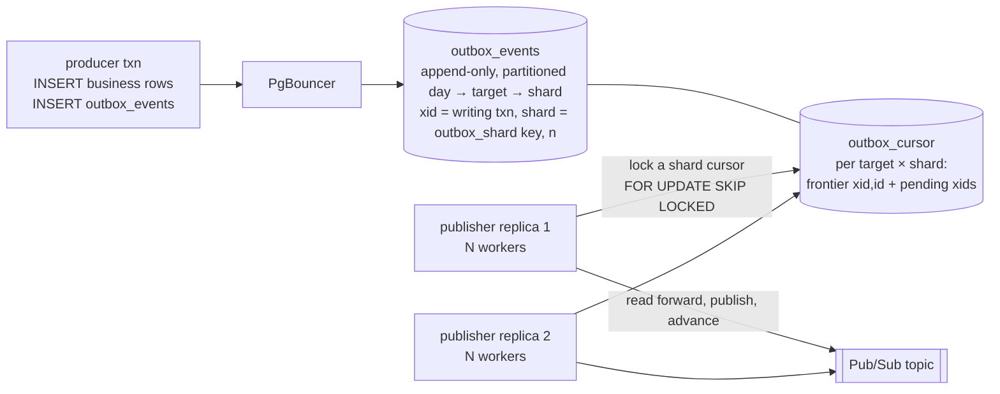
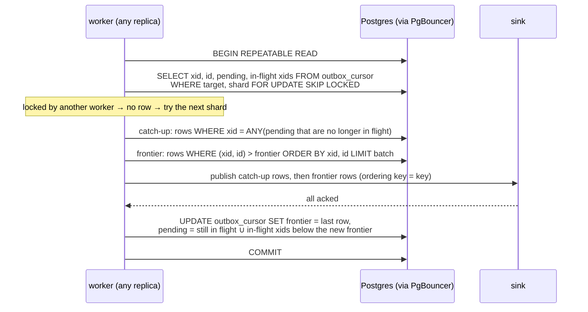

# `cursor`: an append-only table read by per-shard cursors

Producers insert into a partitioned, insert-only table. Publishers read it forward from
a per-shard cursor and never delete; old partitions are dropped. It needs nothing beyond
an ordinary Postgres, runs through PgBouncer end to end, and scales publishing by adding
replicas. It is the strategy for clusters where `wal_level = logical` is not an option.

Stack: `postgres-cursor` (default `wal_level`), `pgbouncer-cursor`, `outbox-cursor`
(`/cursorrelay`, 8 workers by default), `producer-cursor`. Schema and partition
management functions: [`postgres/10-cursor.sql`](../postgres/10-cursor.sql). Relay:
[`relay/cmd/cursorrelay/main.go`](../relay/cmd/cursorrelay/main.go). The dead-letter
design, and the argument that nothing can get stuck, is on its own page:
[cursor-dead-letters.md](cursor-dead-letters.md).

## How it works



Producers write one row:

```sql
INSERT INTO outbox_events (target, key, payload) VALUES ($1, $2, $3);
```

The table fills in `xid`, `pg_current_xact_id()`, the id of the writing transaction.
A row's shard is not stored: it is `outbox_shard(key, n)`, a hash of the ordering key
modulo the target's shard count, used both as a partition key and in the relay's
predicate. Producers never see it. Nothing ever updates or deletes a row.

`outbox_cursor` holds, per `(target, shard)`, the frontier `(xid, id)` of the last row
published, a `pending` array of transaction ids, and a catch-up watermark. A publisher replica runs N workers;
each worker picks a shard and runs one transaction:



### Why a plain id cursor is wrong, and what fixes it

Sequence ids are assigned at insert time, not commit time. A slow transaction can hold
a low id and commit after a fast one with a higher id has been read; a cursor that moved
past the high id would never see the low one. Delete-based outboxes exist to avoid
exactly this. The fix is to record the writing transaction's id, order by it, and let
the cursor remember which transactions were still in flight when it passed them:

- Every poll runs under one repeatable-read snapshot and reads the snapshot's in-flight
  transaction list with `pg_snapshot_xip(pg_current_snapshot())`. That list is the only
  cheap, exact answer to "which transactions below my new frontier might still commit
  rows behind it". Everything below the snapshot's `xmin` has finished; everything in
  the list might not have.
- The frontier moves forward through visible rows in `(xid, id)` order. Visible means
  committed, so nothing uncommitted is ever published.
- In-flight transaction ids below the new frontier go into the cursor's `pending` set.
  On a later poll, pending ids no longer in flight have resolved; their rows, if they
  committed, are read by a separate catch-up query and published first, with a
  `catchup=true` attribute. Aborted ones simply have no visible rows and drop out.

The invariant: **every committed row at or below the frontier has been published unless
its transaction is in `pending`.** A transaction held open for five minutes costs
nothing while it runs and its rows arrive on the first poll after it commits. The
simpler alternative, reading only below the snapshot's `xmin`, would stall every shard
for the whole five minutes, and any open transaction in the database would do it, not
just outbox writers.

### Partitions: day, then target, then shard

```
outbox_events                              RANGE (created_at)
└── outbox_events_20261011                 LIST (target)
    ├── outbox_events_20261011_payments    LIST (outbox_shard(key, 32)): 32 leaves, index (xid, id)
    ├── outbox_events_20261011_orders      LIST (outbox_shard(key, 4)):   4 leaves
    └── outbox_events_20261011_default     every target not listed, index (target, outbox_shard(key, 32), xid, id)
```

`outbox_targets (target, shards)` lists the targets that get their own subtree and how
many shards each has. `outbox_create_partitions(day)` builds a day from it, run daily
for today plus a week. A target that is not listed lands in the day's default child
and uses the default shard count; it can be promoted by inserting a row and running
the function for future days, which affects partitions from then on with no data
movement because time is the top level. There is deliberately no top-level default
partition; see *Maintenance* below for why.

What the tree buys:

- Every poll prunes to one leaf per day partition, and that leaf's index is `(xid, id)`,
  appended at its right edge. The relay's predicate is `target = $1 AND outbox_shard(key,
  n) = $2` with the target's `n` inlined as a literal, which is what lets the planner
  prune at plan time through a transaction-mode pooler.
- Shard count, partition period and retention are per target. A hot target can have 64
  shards and three days; a quiet one four shards and a month.
- A target's rows are contiguous in their own heap, so a quiet target's batch is not
  scattered through a hot target's pages.
- Statistics, analyze and freeze work are per target.

Why not native hash partitioning: a poll cannot ask the parent for "bucket 5", only for
rows whose key equals a value, so `PARTITION BY HASH (key)` would make every poll scan
all buckets. A LIST partition on an explicit modulo expression is addressable. And why
the shard is not a stored column: Postgres will not partition on a generated column.

Partition count is days × (sum of listed shard counts + 1). Ten listed targets at 32
shards with nine days present is about 3,000 leaves; pruning keeps each poll at one
leaf per day, but every poll is planned, so keep shard counts proportionate to each
target's rate rather than defaulting everything to the maximum.

### Maintenance, and what is online

There is no data rebalancing anywhere in this design. A shard owns a cursor position,
not rows; a replica owns nothing. Changing replicas, shards or targets never moves a
row. What has to be managed is the partition tree, and whether that is online comes
down to which lock each piece of DDL takes, measured on Postgres 18 with a producer
transaction held open:

| operation | lock on `outbox_events` | behind an open producer transaction |
|---|---|---|
| `CREATE TABLE … PARTITION OF outbox_events` | ACCESS EXCLUSIVE | waits for it, and blocks every new insert while waiting |
| `ALTER TABLE outbox_events ATTACH PARTITION` of a prebuilt day | SHARE UPDATE EXCLUSIVE | completes at once |
| `DROP TABLE` of an attached day | ACCESS EXCLUSIVE | waits, blocking inserts |
| `DETACH PARTITION … CONCURRENTLY`, then `DROP` | SHARE UPDATE EXCLUSIVE | waits for it to finish, but inserts and relay polls proceed meanwhile; the drop of the detached table is instant |

Two consequences are built in. Days are built standalone and attached, never created
in place, and there is no top-level default partition, because a default partition
makes concurrent detach refuse to run. Every DDL runs with a `lock_timeout` and a
retry.

**Daily partitions.** `outbox_create_partitions(day)` for today plus a week, on a
schedule. Online. Alert when fewer than three days ahead exist, since without a
default partition a missing day fails inserts.

**Promoting a target to its own subtree.** Insert its row in `outbox_targets`, then run
`outbox_create_partitions` for the future days only. Adding a subtree to today's day
would take the strong lock on today's parent, which producers hold locks on, so the
promotion takes effect at the next day boundary; today's rows stay in the default
child and the relay keeps reading them from there. Choose a shard count that is a
multiple of the default: the same count means nothing else changes, a larger one is a
grow as below. Online, no restart.

**Growing a target's shard count.** `outbox_reshard(target, n)`, with `n` a multiple
of the current count. It locks the target's cursor rows for the duration of one
statement, which waits for any poll in flight, copies each cursor to the new shards it
splits into (the keys of new shard `s + k·old` are a subset of old shard `s`, so its
frontier is exact and nothing is republished), rewrites `outbox_targets` with the old
count kept in `previous_shards`, and rebuilds the still-empty future days with the new
modulus. Today's leaves keep the old modulus until the day ages out. Nothing else is
needed: every publisher re-reads `outbox_targets` every few seconds (`-refresh`),
creates any missing cursor rows, which the reshard has already positioned, and widens
its round-robin. While `previous_shards` is set the poll predicate names both moduli,
`outbox_shard(key, old) = s % old AND outbox_shard(key, new) = s`, so partitions built
with either prune to one leaf; the partition job calls
`outbox_clear_previous_shards()` and the extra term disappears once no attached day
carries the old modulus. Fully online, no restart, no day of degraded pruning. The
same mechanism covers promotion with a larger count than the default: the default
count is the previous one.

**Shrinking.** Not exact online, because merging cursors has no subset property. Two
ways. Pause the target's publishers until every cursor has caught up, give each new
shard the minimum frontier and the union of pending over the old shards it merges,
rewrite the count, restart: no duplicates. Or do the same without pausing: the rows
between the minimum and each merged cursor's own frontier are published twice, bounded
by how far apart the cursors were, which is small when the target is caught up.
Partitions follow the same rule as growing.

**Demoting a target.** Delete its row; future days route it to the default child. If
its shard count was not the default it is a shrink or grow first. Rarely worth doing.

**Retention.** `outbox_droppable_partitions(keep)` lists the days older than the
retention whose highest `xid` is below every cursor frontier and every pending id. The
job then runs, outside a transaction, `DETACH PARTITION … CONCURRENTLY` and `DROP TABLE`
for each. Nothing can age out unpublished, and the relay's reads have no time bound for
the same reason. Per-target retention inside a kept day means detaching that target's
subtree from an old day's parent, which only relays touch, with ACCESS SHARE locks held
for one poll at a time; a plain detach there waits at most one batch.

**Changing a target's partition period.** Only future days are affected, so it is a
change to what the creation job builds and takes effect at the next boundary.

### Shards are how replicas help

One cursor per target would mean one active publisher, however many replicas run. So
the key is hashed into a fixed number of shards at insert time and there is one cursor
per shard. A key always lands in one shard and a shard has one lock holder at a time,
so per-key order is as good as with a single cursor.

There is no dispenser across replicas. Inside one replica a round-robin counter spreads
its workers over the shards so they do not pile onto shard 0. Across replicas the
cursor row lock is the only arbiter: whoever claims a shard with `FOR UPDATE SKIP
LOCKED` first owns it for one batch, the loser sees no row and moves on without
sleeping, and within a few polls the replicas desynchronise naturally. The lock is
held for exactly one batch, so shards flow to whichever worker is free. There is no
assignment, nothing in the pod, nothing to rebalance; a dead replica's locks are
released on rollback and the next worker re-reads from the unchanged frontier. The
benchmark's two replicas split 100,000 events 50,228 to 49,772 with no coordination.

The shard count is the parallelism ceiling: at most `shards` batches in flight per
target. Beyond that many workers in total, extra workers only spin on skipped locks,
so ten replicas of a 32-shard target should run three workers each, not eight. The
count is per target in `outbox_targets` and grows online as described above. Postgres
has no consistent hashing and this design does not need it.

### Where the churn goes

The producer inserts one row. The relay reads rows and updates one cursor row per
batch, a HOT update on a one-row-per-shard table with `fillfactor = 50`. Nothing deletes
from the event table; daily partitions are dropped after a retention period. Dead
tuples per event: zero. The relay never locks or dirties a producer page, since its
reads are ordinary snapshot reads, so the contention that made the table relay's claim
48× slower under load does not arise.

With one leaf per shard, every insert is a right-edge append on that leaf's `(xid, id)`
index. The benchmark's 100,000-event runs end with 6.1 MB of index at 88 percent leaf
density and no fragmentation, against the journal's 4.1 MB at 92 percent. An earlier
layout with a single `(target, shard, xid, id)` index per day had 32 interleaved
insertion points and filled at 52 percent density and 8.8 MB; the per-shard leaves are
what removed that. The heaps end with about 15 percent free space rather than 3,
because 32 writers extending 32 small relations concurrently leave partially filled
pages behind; later inserts fill them, so it is unused room, not dead space.

### Failure

A crash after publish and before commit leaves the cursor where it was, so the batch is
republished. Delivery is at-least-once and consumers dedupe on the `outbox_id`
attribute. Transient publish errors roll the poll back and the cursor waits. Permanent
per-message rejections need a policy, because a cursor cannot skip a row the way a
delete-based relay can: see [cursor-dead-letters.md](cursor-dead-letters.md), which
also lists every other way a shard could stall and the bound on each.

### Bulk producers

Multi-row `INSERT` and `COPY` into the partitioned table work unchanged: each row is
routed to its day, target and shard leaf, at about 5 µs per row for a thousand-row
statement on the benchmark host. All rows of one statement share a transaction id and
take ascending ids, so they are published in insert order and per-key order holds
within the bulk. A bulk transaction that was held open long enough to enter the
pending set drains at the batch size too: catch-up rows are read in `(xid, id)` order
with the same limit, a transaction id leaves `pending` only once its rows are
exhausted, and the cursor row carries a catch-up watermark, `(catchup_xid,
catchup_id)`, for the one transaction a poll left half-read. A full catch-up batch
owns its poll; the frontier read waits for the next one.

### Ordering

Rows leave in `(xid, id)` order, the order transactions first wrote, not the order they
committed. Two transactions on the same key usually serialise on that key's business
row, so per-key order holds when that row is the transaction's first write. A
transaction that writes other rows first can take its id early and commit late. The
table outbox has the same property; only logical decoding gives commit order.

### PgBouncer, idle cost, deployment

The whole poll is one transaction with nothing session-scoped, so the relay connects
through the pooler in transaction mode like the producers, using pgx's describe-cache
mode rather than server-side prepared statements. Each worker holds one pooled
connection for the length of a batch, mostly waiting on acks, so size the pool for
replicas × workers and give the relay role an idle-in-transaction timeout matched to
the publish deadline.

A worker sleeps after an empty poll, starting at the poll interval and doubling for
every full sweep of the shards that found nothing, up to a ceiling of one second, so an
idle deployment settles at about workers per second in tiny transactions and still
notices new work within a second. A worker also leaves a shard after ten consecutive
full batches so one hot key range cannot starve the rest. Every poll is planned, and
planning walks the day partitions and prunes each to one leaf, so the cost grows with
the number of days retained and, more slowly, with the number of leaves.

Deployment: a Deployment per target, the same shape as a table-outbox publisher, with
topic, target, shard count and worker count from the environment. Replicas is the
throughput knob. No volume, no StatefulSet, no leader election, no direct primary
connection. Autoscale on the age of the oldest unpublished row, which is one index
probe past each cursor, not on CPU.

## Against the requirements

| | | |
|---|---|---|
| R1 atomic | ✅ | The row is in the producer's transaction. |
| R2 low churn | ✅ | Zero dead tuples, zero deletes, 0 % dead and 3 % free heap at the end of every benchmark run, one HOT update per batch on a tiny cursor table. Per-shard leaves make every index insert a right-edge append. |
| R3 simple | ◐ | An ordinary table, visible and queryable in SQL, and one query per poll. The thing to understand is one invariant, the pending set, and it is stated above in a sentence. More to hold in your head than the table, far less than a replication slot. |
| R4 no logical decoding | ✅ | Default `wal_level`, no slot, no replication role. The benchmark ran it on a plain Postgres. |
| R5 PgBouncer | ✅ | Producer and publisher both through the pooler in transaction mode. The benchmark's publisher connections all went through `pgbouncer-cursor`. |
| R6 long transactions | ✅ | The pending set exists for this. The benchmark held a transaction open for 30 seconds across a run: drain time 33.3 s against 31.1 s without it, and the held event published a few seconds after its commit via catch-up. |
| R7 deployment per target, replicas | ✅ | Any number of replicas share a target through row locks alone, no leader, no state in the pod. One stream drained a 100,000 backlog in 29.5 s; 8 workers in 5.5 s; 8 × 2 replicas in 4.3 s. The ceiling is the target's shard count, set per target and grown online. |
| R8 at-least-once, never lose | ✅ | Publish then advance in one transaction; a crash republishes. No slot to lose. |
| R9 cannot get stuck | ◐ | Designed, not built. The dead-letter page gives the mechanism, an escalation rule that does not depend on classifying error codes correctly, the bound on every other stall, and a one-statement replay. Until it is implemented, a permanently rejected message freezes its shard. |
| R10 ordering | per key | Transaction-id order, which preserves per-key order in the normal case. Commit order is given up, and was not required. |

## Before production

- The dead-letter table, per-shard backoff columns and escalation rule from the
  dead-letter page, with a skip or quarantine ordering policy chosen per target.
- `outbox_create_partitions` on a daily schedule for today plus a week, and for future
  days after every change to `outbox_targets`; a retention job that detaches
  concurrently and drops what `outbox_droppable_partitions` lists; an alert when fewer
  than three days ahead exist.
- Pool sizing for replicas × workers, an idle-in-transaction timeout for the relay
  role, and a publish deadline shorter than it.
- Alerts on oldest unpublished row age per target, on any cursor with failures or with
  a backlog and a stale `updated_at`, and on open dead letters.
- Consumers idempotent on `outbox_id`.

## Run it

```sh
docker compose up -d postgres-cursor pgbouncer-cursor
docker compose --profile bench build
docker compose run --rm outbox-cursor &                  # 8 workers, through pgbouncer-cursor
docker compose run --rm outbox-cursor &                  # a second replica
docker compose exec postgres-cursor psql -U outbox -d outbox -c \
  "BEGIN; INSERT INTO outbox_events (target, key, payload) VALUES ('target_1','LONG','{}'); SELECT pg_sleep(30); COMMIT;" &
docker compose run --rm producer-cursor -events 10000 -workers 16 -rollback-every 10
# both replicas publish straight away; totals reach 9000 while the transaction is still
# open, then 9001 the moment it commits: "published 1 (... catchup=1 ...)"

docker compose run --rm -e RELAY_WORKERS=2 outbox-cursor # fewer pollers per replica
```

Useful while it runs:

```sql
-- docker compose exec postgres-cursor psql -U outbox -d outbox
select shard, xid, id, cardinality(pending) as pending, now() - updated_at as since_progress
from outbox_cursor where target = 'target_1' order by shard;

-- backlog ahead of each cursor (n = the target's shard count)
select c.shard, count(e.*) as unpublished, min(e.created_at) as oldest
from outbox_cursor c
left join outbox_events e on e.target = c.target and outbox_shard(e.key, 32) = c.shard and (e.xid, e.id) > (c.xid, c.id)
where c.target = 'target_1' group by c.shard order by c.shard;

select outbox_reshard('target_2', 8);                   -- grow a target online, then restart its publishers
select * from outbox_droppable_partitions('7 days');    -- days every cursor has passed; detach concurrently, then drop
```
