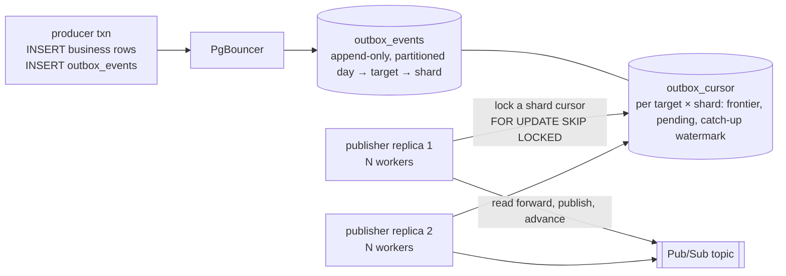
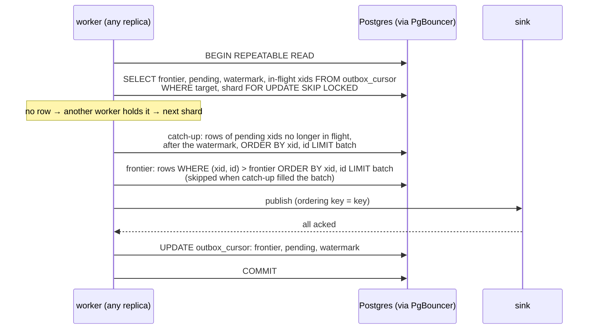

# `cursor`: an append-only table read by per-shard cursors

Producers insert into a partitioned, insert-only table. Publishers read it forward from
per-shard cursors and never delete; old partitions are dropped. It runs on a default
Postgres configuration, through PgBouncer end to end, and scales publishing by adding
replicas.

Stack: `postgres-cursor`, `pgbouncer-cursor`, `outbox-cursor` (`/cursorrelay`),
`producer-cursor`. Schema and partition functions:
[`postgres/10-cursor.sql`](../postgres/10-cursor.sql). Relay:
[`relay/cmd/cursorrelay/main.go`](../relay/cmd/cursorrelay/main.go). Dead letters are
designed, not built: [cursor-dead-letters.md](cursor-dead-letters.md).

## How it works



The producer writes one row per event:

```sql
INSERT INTO outbox_events (target, key, payload) VALUES ($1, $2, $3);
```

The table adds `xid`, the writing transaction's id from `pg_current_xact_id()`. A
row's shard is `outbox_shard(key, n)`, the key's hash modulo the target's shard count;
it is a partition key and a predicate, not a stored column. Nothing updates or deletes
a row. Multi-row `INSERT` and `COPY` work unchanged; all rows of one statement share an
xid and take ascending ids.

`outbox_cursor` has one row per `(target, shard)`: the frontier `(xid, id)` of the last
row published, a `pending` array of transaction ids, and a catch-up watermark. A
publisher runs N workers. Each worker takes a shard and runs one transaction:



### Why the cursor is `(xid, id)` with a pending set

Ids are assigned at insert time, not commit time, so a slow transaction can hold a low
id and commit after a higher id has been read. A cursor on id alone would skip it. The
relay therefore orders by the writing transaction's id and remembers the transactions
that were still open when the frontier passed them:

- Each poll runs under one repeatable-read snapshot and reads the snapshot's in-flight
  transaction list with `pg_snapshot_xip(pg_current_snapshot())`.
- The frontier advances through visible rows in `(xid, id)` order. Visible means
  committed, so nothing uncommitted is published.
- In-flight xids below the new frontier are added to `pending`. On a later poll, a
  pending xid no longer in flight has resolved: its rows, if it committed, are read by
  the catch-up query and published with a `catchup=true` attribute; if it aborted there
  are no rows and it drops out.
- Catch-up reads are bounded by the batch size. An xid leaves `pending` only when its
  rows are exhausted; the one an exhausted batch cut short stays, with the last row
  published recorded in `(catchup_xid, catchup_id)`.

Invariant: **every committed row at or below the frontier has been published, unless
its xid is in `pending`.** An open transaction costs nothing while it runs and its rows
are published on the first poll after it commits. Reading only below the snapshot's
`xmin` would instead stall every shard for as long as any transaction in the database
stays open.

### Partitions: day, then target, then shard

```
outbox_events                              RANGE (created_at)
└── outbox_events_20261011                 LIST (target)
    ├── outbox_events_20261011_payments    LIST (outbox_shard(key, 32)): 32 leaves, index (xid, id)
    ├── outbox_events_20261011_orders      LIST (outbox_shard(key, 4)):   4 leaves
    └── outbox_events_20261011_default     targets not listed, index (target, outbox_shard(key, 32), xid, id)
```

- `outbox_targets (target, shards, previous_shards)` lists the targets with their own
  subtree and their shard counts. Targets not listed share the day's default child and
  the default count of 32.
- `outbox_create_partitions(day)` builds a day: a standalone day table, one subtree per
  listed target, the default child, then one `ATTACH PARTITION`. It is idempotent and
  runs daily for today plus seven days.
- There is no top-level default partition, because a default partition forbids
  concurrent detach (see Maintenance).
- The relay's predicate is `target = $1 AND outbox_shard(key, n) = $2` with `n`
  inlined as a literal, so the planner prunes to one leaf per day at plan time, which
  works through a transaction-mode pooler because there are no server-side prepared
  statements. While `previous_shards` is set the predicate also names that modulus, so
  partitions built before a grow prune the same way.

What this gives: each poll reads one `(xid, id)` index per day, appended at its right
edge; shard count, partition period and retention are per target; a target's rows are
contiguous in their own heap; statistics and vacuum work are per target.

Two Postgres constraints shape it. A stored generated column cannot be a partition key,
so the shard is an immutable function. Native `PARTITION BY HASH (key)` cannot be
addressed by bucket from the parent, so a poll for one shard would scan every bucket;
`LIST` on the explicit modulo expression is addressable.

Partition count is days × (sum of listed shard counts + 1). Every poll is planned, so
size shard counts to each target's rate rather than defaulting all to the maximum.

### Shards and replicas

A key always hashes to one shard, and a shard's cursor row has one lock holder at a
time, so per-key order is as good as with a single cursor. Workers in every replica
claim shards with `FOR UPDATE SKIP LOCKED`, hold the lock for one batch, and move on; a
worker that finds a shard locked tries the next without sleeping. There is no
assignment, no leader, no state in the pod, and a dead replica's lock is released on
rollback. In the benchmark two replicas split 100,000 events 50,033 to 49,967 with no
coordination.

The shard count is the ceiling on concurrent batches per target. Workers beyond it only
spin on skipped locks, so ten replicas of a 32-shard target should run three workers
each. Within one replica a round-robin counter spreads workers over shards. A worker
leaves a shard after ten consecutive full batches (`-max-full`) so one hot key range
cannot starve the rest.

### Churn

The producer inserts one row. The relay reads under a snapshot and updates one cursor
row per batch, a HOT update on a `fillfactor = 50` table. Nothing deletes from the event
table. Measured on 100,000 events: zero dead tuples, zero deleted index pages, index
6.4 MB at 88 percent leaf density against the journal's 4.1 MB at 92 percent. A single
`(target, shard, xid, id)` index per day, the layout before per-shard leaves, measured
8.8 MB at 52 percent because 32 shards meant 32 interleaved insertion points. The heaps
end with 15 to 19 percent free space because 32 producer connections extend 32 small
relations concurrently; later inserts fill it.

### Ordering and delivery

Rows leave in `(xid, id)` order, the order transactions started, not the order they
committed. Per-key order holds when the key's business row is the transaction's first
write, which is the normal case. Commit order needs logical decoding.

Delivery is at-least-once. A crash after publish and before commit leaves the cursor
where it was and the batch is republished; consumers dedupe on the `outbox_id`
attribute. A transient publish error rolls the poll back. A permanent per-message
rejection currently freezes its shard; the dead-letter design fixes that.

### Operation

- **PgBouncer.** The poll is one transaction with nothing session-scoped. The relay uses
  pgx's describe-cache mode. Each worker holds a pooled connection for one batch, mostly
  waiting on acks, so size the pool for replicas × workers and give the relay role an
  idle-in-transaction timeout longer than the publish deadline.
- **Idle cost.** After an empty poll a worker sleeps for `-poll` (100 ms), doubling per
  empty sweep of the shards up to `-poll-max` (1 s). An idle deployment settles at about
  one tiny transaction per worker per second and notices new work within a second.
- **Configuration refresh.** Every `-refresh` (5 s) each publisher re-reads its target's
  row in `outbox_targets`, creates any missing cursor rows and rebuilds its queries, so
  a shard-count change needs no restart.
- **Deployment.** One Deployment per target, with target, topic and worker count from
  the environment. Replicas are the throughput knob. No volume, no leader election, no
  direct primary connection. Autoscale on oldest unpublished row age.

### Maintenance

Nothing moves rows. A shard owns a cursor position and a replica owns nothing, so
replicas, shard counts and targets change without data movement. What is managed is
the partition tree, and whether that is online depends on locks. Measured on Postgres
18 with a producer transaction held open:

| operation | lock on `outbox_events` | effect while a producer transaction is open |
|---|---|---|
| `CREATE TABLE … PARTITION OF outbox_events` | ACCESS EXCLUSIVE | waits for it and blocks every new insert while waiting |
| `ATTACH PARTITION` of a prebuilt day | SHARE UPDATE EXCLUSIVE | completes at once |
| `DROP TABLE` of an attached day | ACCESS EXCLUSIVE | waits, blocking inserts |
| `DETACH PARTITION … CONCURRENTLY`, then `DROP` | SHARE UPDATE EXCLUSIVE | waits for it, inserts and polls continue; the drop is instant |

Run every DDL with a `lock_timeout` and a retry.

- **Daily partitions.** `outbox_create_partitions(day)` for today plus seven, on a
  schedule. Alert when fewer than three future days exist; a missing day fails inserts.
- **Promote a target.** Insert its `outbox_targets` row, then run the creation function
  for future days only. Today's day keeps routing the target to its default child, and
  the relay reads it there; the subtree takes effect at the next day boundary. Use the
  default count or a multiple of it.
- **Grow a shard count.** `outbox_reshard(target, n)`, `n` a multiple of the current
  count. It locks the target's cursor rows for one statement, copies each cursor to
  the shards it splits into (new shard `s + k·old` holds a subset of old shard `s`'s
  keys, so the copy is exact and nothing is republished), records the old count in
  `previous_shards`, and rebuilds the still-empty future days. Publishers pick up the
  change on their next refresh. `outbox_clear_previous_shards()`, run by the partition
  job, nulls `previous_shards` once no attached day carries the old modulus. Online,
  no restart.
- **Shrink a shard count.** Not exact online. Pause the target's publishers until every
  cursor has caught up, give each new shard the minimum frontier and the union of
  pending over the shards it merges, update the count, resume. Done without pausing,
  the rows between the minimum and each merged frontier are published twice.
- **Demote a target.** Delete its row; future days route it to the default child. A
  non-default count is a shrink or grow first.
- **Retention.** `outbox_droppable_partitions(keep)` lists days older than `keep` whose
  highest xid is below every cursor frontier and every pending xid. The job runs
  `DETACH PARTITION … CONCURRENTLY` then `DROP TABLE` for each, outside a transaction.
  Relay reads have no time bound, so nothing can age out unpublished. Per-target
  retention inside a kept day is a plain detach of that target's subtree from the old
  day's parent, which only relays touch.

## Against the requirements

| | | |
|---|---|---|
| R1 atomic | ✅ | The row is in the producer's transaction. |
| R2 low churn | ✅ | Zero dead tuples, zero deletes, zero deleted index pages; one HOT update per batch on a tiny cursor table; per-shard leaves make every index insert a right-edge append. |
| R3 simple | ◐ | An ordinary table, queryable in SQL, one query per poll. The one thing to understand is the pending-set invariant. More than the table, far less than a replication slot. |
| R4 no logical decoding | ✅ | Default `wal_level`, no slot, no replication role. |
| R5 PgBouncer | ✅ | Producer and publisher both through the pooler in transaction mode. |
| R6 long transactions | ✅ | The pending set exists for this. Benchmark: a transaction held open for 30 s did not change drain time; its event was published a few seconds after its commit. |
| R7 deployment per target, replicas | ✅ | Replicas share a target through row locks alone. Backlog of 100,000: one stream 29.5 s, 8 workers 6.7 s, 8 × 2 replicas 4.7 s. Ceiling is the target's shard count, grown online. |
| R8 at-least-once, never lose | ✅ | Publish then advance in one transaction; a crash republishes. No slot to lose. |
| R9 cannot get stuck | ◐ | Designed, not built. Until the dead-letter path exists a permanently rejected message freezes its shard. |
| R10 ordering | per key | Transaction-id order; per-key order in the normal case. Commit order given up. |

## Before production

- Build the dead-letter path.
- Schedule `outbox_create_partitions`, `outbox_clear_previous_shards` and the retention
  job; alert on fewer than three future days.
- Size the pool for replicas × workers; set the relay role's idle-in-transaction
  timeout above the publish deadline.
- Alert on oldest unpublished row age per target and on cursors with a backlog and a
  stale `updated_at`.
- Consumers idempotent on `outbox_id`.

## Run it

```sh
docker compose up -d postgres-cursor pgbouncer-cursor
docker compose --profile bench build
docker compose run --rm outbox-cursor &                  # 8 workers, through pgbouncer-cursor
docker compose run --rm outbox-cursor &                  # a second replica
docker compose exec postgres-cursor psql -U outbox -d outbox -c \
  "BEGIN; INSERT INTO outbox_events (target, key, payload) VALUES ('target_1','LONG','{}'); SELECT pg_sleep(30); COMMIT;" &
docker compose run --rm producer-cursor -events 10000 -workers 16 -rollback-every 10
# totals across the replicas reach 9000 while the transaction is open, then 9001 when it
# commits: "published 1 (... catchup=1 ...)"
```

```sql
-- docker compose exec postgres-cursor psql -U outbox -d outbox
select shard, xid, id, cardinality(pending) as pending, now() - updated_at as since_progress
from outbox_cursor where target = 'target_1' order by shard;

-- backlog ahead of each cursor (32 = the target's shard count)
select c.shard, count(e.*) as unpublished, min(e.created_at) as oldest
from outbox_cursor c
left join outbox_events e on e.target = c.target and outbox_shard(e.key, 32) = c.shard and (e.xid, e.id) > (c.xid, c.id)
where c.target = 'target_1' group by c.shard order by c.shard;

select outbox_reshard('target_2', 8);                   -- grow online; publishers pick it up within -refresh
select * from outbox_droppable_partitions('7 days');    -- then DETACH ... CONCURRENTLY and DROP each
```
