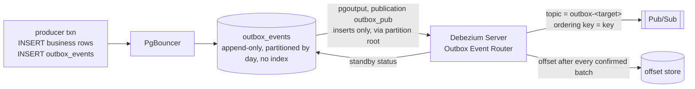

# `debezium`: an append-only table decoded from the log by Debezium Server

Producers insert into a partitioned, insert-only table that nothing ever reads.
Debezium Server decodes the inserts from the write-ahead log through a pgoutput
publication, routes each row to its target's topic with its Outbox Event Router, and
publishes. There is no relay code, no relay query, no cursor and no index: the table is
a heap written once, and old days are dropped. It is the `cursor` table with the
publishing side replaced by a prebuilt product and a replication slot.

Stack: `postgres-debezium` (`wal_level=logical`), `pgbouncer-debezium`,
`outbox-debezium` (the `quay.io/debezium/server` image), `sink-debezium` (the benchmark's
simulated Pub/Sub, `/httpsink`), `producer-debezium`. Schema:
[`postgres/10-debezium.sql`](../postgres/10-debezium.sql). Configuration:
[`debezium/application.properties`](../debezium/application.properties). Dead letters
are designed, not built: [debezium-dead-letters.md](debezium-dead-letters.md).

## How it works



The producer writes the same statement as the cursor transport:

```sql
INSERT INTO outbox_events (target, key, payload) VALUES ($1, $2, $3);
```

The publication is created by the schema, not by the connector, and is limited to what
the outbox needs:

```sql
CREATE PUBLICATION outbox_pub FOR TABLE outbox_events
  WITH (publish = 'insert', publish_via_partition_root = true);
```

Inserts only, because nothing else ever happens to a row. Via the partition root, so
Debezium sees one table however many day partitions exist and however often they
rotate. Debezium's `table.include.list` names only that root.

The Outbox Event Router turns one row into one message: `target` picks the topic
(`outbox-<target>`), `key` becomes the message key and therefore the Pub/Sub ordering
key, `payload` is the body, and `id` and `target` travel as headers. With
`snapshot.mode=no_data` the connector never reads the table; its first start streams
from the slot's creation point.

Requirements on the database: Postgres 13+ for `publish_via_partition_root`, a role
with `REPLICATION`, `wal_level = logical`, a free `max_replication_slots`.

## Progress and restarts

Debezium keeps two positions, the same shape as [`journal`](journal.md):

| position | where it lives | what it means |
|---|---|---|
| `confirmed_flush_lsn` | the slot, in Postgres | Postgres may discard log before this; Debezium advances it only after a batch has been fully handed to the sink |
| the offset | Debezium's offset store | the commit position of the last transaction and the position of the last event processed inside it, flushed after every batch the sink confirms |

The loop: pgoutput delivers one committed transaction at a time, Debezium queues the
events, the sink publishes a batch and marks each record processed, the engine commits
the offset and flushes the position to Postgres. Nothing is acknowledged before the
sink has accepted it.

On a restart the connector reads its offset, attaches to the slot, and skips events at
or below the offset; because the offset records the last event inside a transaction,
it resumes mid-transaction rather than replaying the whole of it. Anything the sink
accepted after the last offset flush and before the crash is published again: that is
the at-least-once window, and consumers dedupe on the `id` header. Measured here:
stop, produce 500, start, and exactly 500 more arrive.

The two stores can disagree after a failure:

| state | result |
|---|---|
| offset lost, slot present | streams from the slot, replays the gap, duplicates only |
| slot lost, offset present | creates a new slot at the current position and skips the gap silently |
| both lost | fresh start; `snapshot.mode` decides whether anything old is read |

The second row is the failover case. Postgres 17 failover slots cover a promotion where
the host synchronises slots to its standbys; Debezium's `slot.failover` asks for one. Where that is
not available the rows are still in the table, so the lost window can be republished
from SQL by id, which is a manual or scripted step rather than a built-in path.

The prototype keeps the offset in a file on the `state/debezium` volume. In real use
it belongs in Redis or a JDBC store, for the same reason the `wal` relay's state file
needs durable storage.

## Partitions and retention

`outbox_events` is range-partitioned by day on `created_at`, created standalone and
attached (ATTACH takes a lock that does not queue behind producer transactions; CREATE
TABLE … PARTITION OF does), with no default partition so that old days can be detached
concurrently. There is no index on any partition: the connector reads the log, not the
table, and the primary-key warning Debezium logs is for update and delete events that
can never occur.

A day may be dropped once the slot has confirmed past every insert into it. The
connector's position is a log position, not a row id, so the partition job records
one: `outbox_close_day(day)` stores `pg_current_wal_lsn()` some time after the day has
ended (longer than the longest producer transaction, so that every row with a
`created_at` in that day has committed), and `outbox_droppable_partitions(keep)` lists
the days older than `keep` whose recorded position the slot's `confirmed_flush_lsn` has
passed. The job then runs `DETACH PARTITION … CONCURRENTLY` and `DROP TABLE` for each,
outside a transaction. pg_partman and pg_cron can do the creating and dropping; the
guard is the only outbox-specific part.

## What it costs and risks

- **Logical decoding.** `wal_level = logical`, a slot, a replication role, and a
  connection that cannot go through PgBouncer. Everything the `wal` page says about
  slot retention, `max_slot_wal_keep_size`, slot invalidation and failover applies.
- **A singleton.** One Debezium Server per slot. It routes every target from one
  stream, so a deployment is one process for all targets, scaled by nothing. A process
  per target is possible with a slot each and a filter transform, at the cost of each
  one decoding the whole stream.
- **A stuck head.** A message the broker rejects permanently is retried by the sink up
  to its total timeout, then the engine stops and the process exits; on restart it
  resumes at the last offset and fails on the same record. `event.processing.failure.handling.mode`
  covers decoding errors only, and Debezium Server has no dead-letter queue. The
  options, from validating at insert to a custom sink, are in
  [debezium-dead-letters.md](debezium-dead-letters.md).
- **Quiet outboxes on busy databases.** With no outbox events there is nothing to
  confirm, so the slot retains log. `heartbeat.interval.ms` fixes that and is off in
  the benchmark configuration so that the sink counts only events.
- **One stream's throughput.** Publishing rate is whatever one Debezium Server can
  decode, transform and post. On the benchmark host that was 100,000 events in 53 s,
  about 1,900 per second and half of a Go relay's single stream, with the sink latency
  accounting for 29 s of it; the engine's JSON expansion and header encoding and the
  shared cores account for the rest. There is no replica knob; a faster host or a
  slot per target is the only way up.
- **A JVM to run.** Debezium Server starts in about ten seconds and idles at a few
  hundred megabytes. Its `/q/health` and `/q/metrics` endpoints expose milliseconds
  behind source, events seen and queue depth.
- **Topic routing is a property.** `route.topic.replacement` carries a `${}` template
  that the properties loader would otherwise expand; it is escaped in the file.
- **Simulated sink in the benchmark.** Debezium's HTTP sink posts batches to
  `/httpsink`, which counts them and charges the same fixed latency per batch as the
  Go relays' simulated sink. For a real project set `DEBEZIUM_SINK_TYPE=pubsub` and a
  project id; the Pub/Sub sink batches to 1,000 with ordering keys on.

## Against the requirements

| | | |
|---|---|---|
| R1 atomic | ✅ | The row is in the producer's transaction. |
| R2 low churn | ✅ | Insert-only heap, no index, partitions dropped. The lightest table of the five: 28 MB of heap for 100,000 events, 3 percent free, zero dead tuples, no index, 47 MB of WAL against 42 for `wal` and 55 for `cursor`. |
| R3 simple | ◐ | No relay code and the backlog is a table you can `SELECT`. But two positions in two places, a slot to watch, and a product with several hundred properties to operate. |
| R4 no logical decoding | ✗ | Requires `wal_level = logical`. |
| R5 PgBouncer | ◐ | The producer runs through the pooler. The replication connection cannot. |
| R6 long transactions | ✅ | Delivered at commit; an open transaction delays only its own events. Benchmark: a transaction held open for 30 s did not lengthen the drain, and its event arrived in commit order once the stream reached its commit. |
| R7 deployment per target, replicas | ✗ | One consumer per slot. A singleton, with the offset store as its state. |
| R8 at-least-once, never lose | ◐ | At-least-once in normal operation and across restarts. A lost slot skips the window silently; the rows survive in the table, so the window is recoverable by hand, not by the product. |
| R9 cannot get stuck | ◐ | Designed, not built. As built a permanently rejected message stops the process; the design validates at insert and adds a custom sink with a dead-letter table. |
| R10 ordering | commit order | Commit order from logical decoding, ordering key per `key`. |

## Before real use

- Offsets in Redis or a JDBC store, not a file.
- `heartbeat.interval.ms` on; alert on slot lag and disk headroom; decide
  `max_slot_wal_keep_size`.
- Failover slots where the host supports them; otherwise a runbook for replaying a
  lost window from the table.
- Schedule `outbox_create_partitions`, `outbox_close_day` and the retention job.
- The dead-letter design, at minimum its first step: payloads validated at insert.
  Until then, an alert on the process restarting, and consumers idempotent on the
  `id` header.

## Run it

```sh
docker compose up -d postgres-debezium pgbouncer-debezium
docker compose --profile bench build
docker compose run --rm --use-aliases sink-debezium &          # the counter Debezium publishes to
docker compose run --rm outbox-debezium &                      # Debezium Server: creates the slot, streams
docker compose run --rm producer-debezium -events 10000 -workers 16 -rollback-every 10
# committed=9000 rolled_back=1000 ... the sink reports total=9000
```

```sql
-- docker compose exec postgres-debezium psql -U outbox -d outbox
select slot_name, active, confirmed_flush_lsn,
       pg_size_pretty(pg_wal_lsn_diff(pg_current_wal_lsn(), confirmed_flush_lsn)) as lag
from pg_replication_slots;

select outbox_close_day(current_date - 1);
select * from outbox_droppable_partitions('7 days');   -- then DETACH ... CONCURRENTLY and DROP each
```

Stop Debezium, produce more, start it again: the sink's total rises by exactly the
number committed while it was down, because the offset and the slot both survived.
