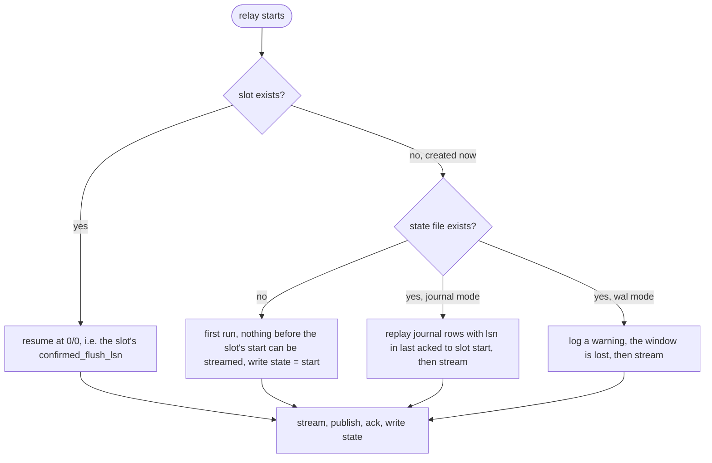

# `journal`: `wal` plus an append-only journal for slot loss

Everything in [`wal`](wal.md), plus a safety net in the spirit of LISTEN/NOTIFY backed
by polling: the log stream is the fast path and an append-only table is the recovery
path. The producer writes both in one statement, storing the message's log position in
the row. In steady state the journal is never read. It exists for one case: the relay
comes back and its slot is gone.

Stack: `postgres-journal` (`wal_level=logical`), `pgbouncer-journal`, `outbox-journal`
(`/relay` with `RELAY_JOURNAL=true`), `producer-journal`. Schema:
[`postgres/20-journal.sql`](../postgres/20-journal.sql), `outbox_journal` partitioned by
day on `created_at`.

## How it works

**What the producer writes.** One statement per event:

```sql
INSERT INTO outbox_journal (target, payload, lsn)
VALUES ($1, $2, pg_logical_emit_message(true, $1, $2));
```

`pg_logical_emit_message` returns the log position of the record it just wrote, and the
INSERT stores it in the row. Both happen inside the business transaction, so a rollback
discards both. Nothing ever updates or deletes a journal row. Old partitions are
dropped after a retention period, so it costs one insert per event and never produces a
dead tuple.

**What the relay tracks.** Two positions, kept in two places:

| position | where it lives | what it means |
|---|---|---|
| `confirmed_flush_lsn` | the slot, in Postgres | Postgres may discard log before this; the relay advances it with a standby status update after a batch is published |
| last acknowledged LSN | the relay's state file, `state/relay_<target>.lsn` | the relay's own copy of the same number, written atomically every time it acknowledges |

In steady state the two agree. The state file exists because the slot is the thing that
disappears in a failover, and the number it held is the only thing that defines the
lost window. In production this file belongs on durable storage outside the database
that just failed over.

**What happens on start.** The relay tries to create its slot, then branches on two
facts: did the slot already exist, and does a state file exist.



The slot-exists path is the normal restart. The created-now path with a state file is a
failover or an operator dropping the slot: the gap between the state file's position
and the new slot's consistent point is exactly what was committed while no slot was
retaining log, and the journal holds it.

**The replay itself.** Over an ordinary connection, not the replication one:

```sql
SELECT payload, lsn::text
FROM outbox_journal
WHERE target = $1 AND lsn > $2::pg_lsn AND lsn <= $3::pg_lsn
ORDER BY lsn, id;
```

`$2` is the state file's position and `$3` the new slot's consistent point. The rows go
through the same sink in relay-sized batches with a `replayed=true` attribute, and the
state file is then set to the consistent point. Only after that does streaming begin,
so a crash during replay replays again from the same position. The benchmark's
slot-loss run replayed exactly 100,000 rows this way in 22.7 seconds.

**The boundary edge.** The stored `lsn` is where the message was written, which is
before its transaction's commit record. A transaction that wrote its message early and
committed late can have a position below one the relay has already acknowledged, while
still being streamed correctly in normal operation because streaming is commit-ordered.
After a slot loss, replaying strictly from the acknowledged position would miss it.
Widen the window downward by at least the longest transaction the producers run, and
rely on consumer dedupe for the duplicates that creates. The prototype replays from the
exact position; a production relay should apply the margin.

**Retention is the one knob.** The journal can only recover what it still holds. Keep
partitions for longer than the longest relay outage you intend to survive, and alert on
journal partition age against that, the same way you alert on slot lag.

## What it costs beyond `wal`

- One row per event, so the journal's insert and index cost come back: 81 MB of WAL
  per 100,000 events against 42 MB for `wal` alone, and a 4 MB index at 92 percent
  leaf density. Still no dead tuples and no vacuum pressure, because nothing is ever
  updated or deleted.
- A second thing to operate: partition creation and retention for the journal, and the
  replay-window margin above.
- Everything else `wal` costs: `wal_level = logical`, the slot, the singleton relay, the
  state file, the direct connection.

## Against the requirements

| | | |
|---|---|---|
| R1 atomic | ✅ | Row and log record are in the same transaction and the same statement. |
| R2 low churn | ✅ | Insert-only, partitions dropped, zero dead tuples; the benchmark's journal heap ended at 0 % dead and 3 % free. More bytes than `wal`, no churn. |
| R3 simple | ✗ | Everything `wal` has to understand, plus two positions in two places, a replay window with a boundary edge, and partition retention. The most moving parts of the four. |
| R4 no logical decoding | ✗ | Requires `wal_level = logical`. Disqualifying on the databases this is for. |
| R5 PgBouncer | ◐ | Producer through the pooler; the relay's replication connection cannot be, and its replay connection could be. |
| R6 long transactions | ✅ | As `wal`, with the replay-window margin as the one place long transactions need thought. |
| R7 deployment per target, replicas | ✗ | One consumer per slot, singleton relay, state file. Same shape as `wal`. |
| R8 at-least-once, never lose | ✅ | The reason it exists: a lost slot becomes a replay of the journal, exact to the row, as long as retention outlasts the outage. |
| R9 cannot get stuck | ◐ | As `wal`: a permanently rejected message heads the stream and a skip-and-record path is possible but not atomic and not designed. The journal does make the stuck event visible and replayable in SQL, which `wal` cannot. |
| R10 ordering | commit order | Streaming is commit-ordered; a replay is `lsn` order, which is write order, with duplicates at the margin. |

## Run it

```sh
docker compose up -d postgres-journal pgbouncer-journal
docker compose --profile bench build
docker compose run --rm outbox-journal &
docker compose run --rm producer-journal -events 10000 -workers 16 -rollback-every 10
# committed=9000 rolled_back=1000 ... the relay publishes exactly 9000
```

Simulate a failover that loses the slot, then watch the relay recover from the journal:

```sh
docker stop $(docker ps -q --filter ancestor=outbox-outbox-journal)
docker compose run --rm producer-journal -events 500 -workers 8     # committed while no relay runs
docker compose exec postgres-journal psql -U outbox -d outbox -c \
  "select pg_drop_replication_slot('outbox_relay_target_1')"
docker compose run --rm outbox-journal
# created slot outbox_relay_target_1 at 0/…
# replayed 500 from outbox_journal for window (0/…, 0/…] total=500
```

```sql
-- docker compose exec postgres-journal psql -U outbox -d outbox
select relname, n_tup_ins, n_tup_del, n_dead_tup from pg_stat_user_tables
where relname like 'outbox_journal%';
```
