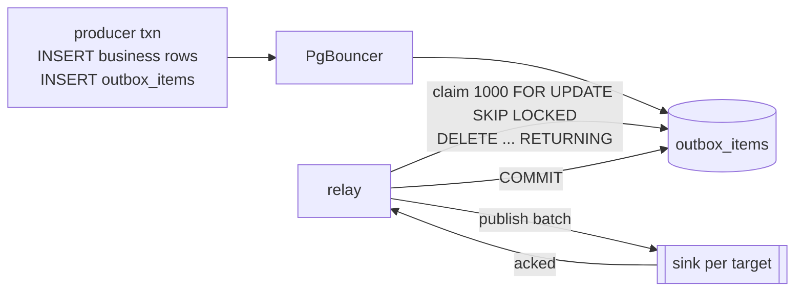

# `table`: the conventional outbox

Insert a row in the business transaction; a relay claims a batch, publishes it, deletes
the rows, commits. It is the baseline. It is correct for atomicity and at-least-once
delivery; its problem is what the deletes do to the table.

Stack: `postgres-table`, `pgbouncer-table`, `outbox-table` (`/tablerelay`),
`producer-table`. Schema: [`postgres/10-table.sql`](../postgres/10-table.sql).

## How it works



The producer writes `INSERT INTO outbox_items (target, payload)` next to its business
rows. The relay loops over one transaction per batch:

```sql
WITH claimed AS MATERIALIZED (
  SELECT id FROM outbox_items WHERE target = $1 ORDER BY id LIMIT $2 FOR UPDATE SKIP LOCKED
)
DELETE FROM outbox_items USING claimed WHERE outbox_items.id = claimed.id
RETURNING outbox_items.id, payload;
```

It publishes the returned rows and commits. A crash before commit rolls the delete back
and the rows are claimed again. `SKIP LOCKED` lets several relays claim disjoint
batches from the same table.

The claim is a materialised CTE on purpose. The form `DELETE … WHERE id IN (SELECT …
LIMIT 1000 FOR UPDATE SKIP LOCKED)` lets the planner rescan the subquery per candidate
row when statistics are stale, which on this stack turned a 1,000-row claim into
minutes of CPU and returned more rows than the LIMIT.

## Where the churn comes from

Every event is one INSERT and one DELETE, so every event leaves a dead tuple and dead
index entries. Under bursty load vacuum falls behind, the claim walks dead entries, the
index grows, and the table needs aggressive autovacuum and periodic reindexing. No
relay query change fixes this; only not deleting does.

One 100,000-event benchmark run:

| | |
|---|---|
| dead tuples at peak | 91,000 |
| heap dead space at the end | 32.5 % |
| heap free space at the end, pages vacuum emptied but cannot return | 65.8 % |
| index pages deleted or empty after vacuum, never reclaimed without REINDEX | 363 |
| relay claim cost per 1,000 events while producers run | 414 ms |
| the same claim once producers stop | 8.7 ms |
| relay buffers touched per 1,000 events | about 9,200 |
| relay WAL written per event, for the delete alone | 292 bytes |

The 48× gap between the claim under load and at rest is the relay locking and deleting
the pages the producers are inserting into. Every other strategy ended the same run
with zero dead space.

## Against the requirements

| | | |
|---|---|---|
| R1 atomic | ✅ | The row is in the producer's transaction. |
| R2 low churn | ✗ | A dead tuple and dead index entries per event. This is the requirement the table fails, and the reason the others exist. |
| R3 simple | ✅ | One table, one query, everything visible in SQL. The simplest strategy here. |
| R4 no logical decoding | ✅ | Plain Postgres. |
| R5 PgBouncer | ✅ | Producer and relay are both transaction-scoped. |
| R6 long transactions | ✅ | A row from an open transaction is invisible until it commits and is claimed then. Nothing waits for it. |
| R7 deployment per target, replicas | ◐ | A deployment per target works, and `SKIP LOCKED` lets replicas share the table. But every replica claims from the same hot pages, so replicas add contention faster than they add throughput, and the claim cost under load above is the result. |
| R8 at-least-once | ✅ | Delete and publish are in one transaction; a crash replays. |
| R9 cannot get stuck | ✅ | A dead-letter flag column: a rejected row is flagged in place and skipped by the claim, and republishing is clearing the flag. Trivial because the relay has no position, it just scans for unflagged rows. |
| R10 ordering | insert order | Batches are claimed in id order, but with several relays batches can overtake each other, so even per-key order is not guaranteed under replicas. Not required. |

## Before production

Aggressive autovacuum settings on `outbox_items`, a scheduled REINDEX or `pg_repack`,
the materialised-CTE claim, and alarms on dead tuples and index size.

## Run it

```sh
docker compose up -d postgres-table pgbouncer-table
docker compose --profile bench build
docker compose run --rm outbox-table &
docker compose run --rm producer-table -events 10000 -workers 16
docker compose exec postgres-table psql -U outbox -d outbox -c \
  "select n_tup_ins, n_tup_del, n_dead_tup from pg_stat_user_tables where relname = 'outbox_items'"
```
