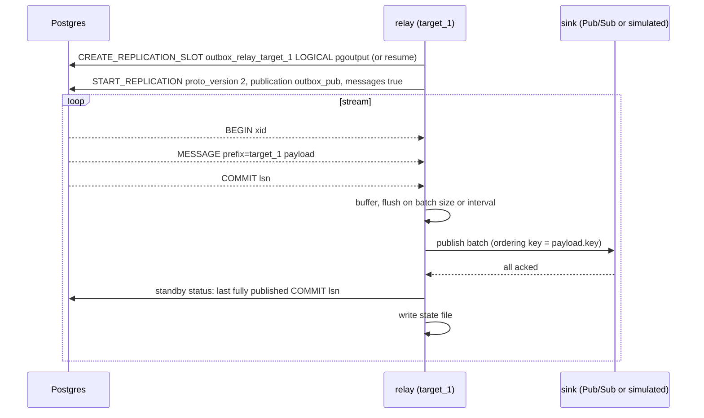

# `wal`: events in the write-ahead log, no table

`pg_logical_emit_message(true, target, payload)` writes the payload into the
write-ahead log as part of the open transaction. It touches no table. A logical
replication slot retains every log record after its confirmed position; a relay reads
the stream over a replication connection, keeps the messages whose prefix is its
target, publishes them in batches, and advances the slot. There is nothing to vacuum
because nothing was written to a table.

Stack: `postgres-wal` (`wal_level=logical`), `pgbouncer-wal`, `outbox-wal` (`/relay`),
`producer-wal`. Schema: [`postgres/10-publication.sql`](../postgres/10-publication.sql),
an empty publication so that only BEGIN, MESSAGE and COMMIT records are streamed.

## How it works



1. Create the slot, or start at LSN `0/0` to resume from the slot's
   `confirmed_flush_lsn`.
2. Stream with `proto_version '2'`, `publication_names 'outbox_pub'`,
   `messages 'true'`. The publication has no tables, so only BEGIN, MESSAGE and COMMIT
   records arrive.
3. Each MESSAGE whose prefix equals the relay's target becomes a message on
   `outbox-<target>`; other prefixes are skipped. Target, key, LSN and xid become
   attributes.
4. Flush on batch size or interval. After every result is confirmed, send a standby
   status update with the last COMMIT LSN fully contained in what has been published,
   and persist it to the relay's state file.

**The acknowledgement rule.** The relay only acknowledges up to the end of a source
transaction whose messages have all been published. A batch that flushes in the middle
of a transaction publishes those messages but leaves the acknowledged position at the
previous commit, so a crash replays that whole transaction. Non-transactional messages
have no commit record and never advance the position; they are replayed on restart
until a later commit passes them. This is what makes delivery at-least-once.

**Targets.** The target is the message prefix. One relay per target has its own slot,
keeps only its prefix, and publishes to its topic, so lag and restarts are independent
per destination. Each relay decodes the whole stream and discards the rest, so
server-side decoding scales with the number of targets.

Requirements on the database: Postgres 14+ for pgoutput messages, a role with
`REPLICATION`, `wal_level = logical`, a free `max_replication_slots`.

## What it costs and risks

- **Nothing to look at.** Pending events are opaque log bytes until the relay decodes
  them. There is no `SELECT` that shows the backlog, and replay is bounded by retained
  log and the slot position. A true backfill means re-deriving events from business
  state.
- **The buffer is the primary's disk.** While the relay is down, the slot retains log.
  `max_slot_wal_keep_size` caps it, and when the cap is hit Postgres invalidates the
  slot and everything unacknowledged is gone. This needs a paging alert on slot lag and
  on disk headroom.
- **Slot loss on failover.** Logical slots live on the primary. A standby that shares
  the primary's disk carries the slot; a streaming replica does not. Postgres 17 adds
  failover slots where the platform supports them; before that, `pg_failover_slots`
  where extensions can be installed. Where neither applies, the window between the
  last acknowledgement and the failover is lost. The [`journal`](journal.md) strategy
  exists to recover exactly that window.
- **One consumer per slot.** A second relay attaching to an active slot is refused.
  Deploys are stop-before-start; scaling out means more targets, not more replicas on
  one target.
- **The state file.** The relay keeps its last acknowledged position outside Postgres,
  because the slot is the thing that disappears in a failover. That file needs durable
  storage: a volume, an object store, or a table in another database.
- **The bytes are still written.** The payload goes into the log, which is fsynced,
  physically replicated and archived. Heap, index and vacuum costs are gone; the write
  itself is not.
- **The relay must not create a slot silently in production.** The prototype does, for
  convenience. A missing slot with existing state should page someone.
- **Thin tooling outside Go and Java.** Debezium handles these messages natively and
  Debezium Server has a Pub/Sub sink. Go has pglogrepl. Most other CDC tools and every
  surveyed Ruby outbox library handle row changes only.

## Against the requirements

| | | |
|---|---|---|
| R1 atomic | ✅ | The message is a record in the transaction's own log. A rollback never produces it. |
| R2 low churn | ✅ | Zero rows, zero dead tuples, zero index. The lightest strategy on every database axis in the benchmark: 42 MB of WAL for 100,000 events against 90 MB for the table. |
| R3 simple | ✗ | Replication protocol, slot lifecycle, a state file, acknowledgement at commit boundaries, and a backlog nobody can `SELECT`. Far more for a team to reason over than a table. |
| R4 no logical decoding | ✗ | Requires `wal_level = logical`, a cluster-wide setting with a restart. Disqualifying on the databases this is for. |
| R5 PgBouncer | ◐ | The producer runs through the pooler. The relay cannot: replication connections go directly to the primary. |
| R6 long transactions | ✅ | Logical decoding delivers a transaction at its commit, so an open transaction delays only its own events. The slot does retain log from the oldest open transaction's start, which is disk, not a stall. |
| R7 deployment per target, replicas | ✗ | One consumer per slot. A deployment per target works, but it is a singleton with stop-before-start deploys and a state file to keep, which is the StatefulSet shape the requirement rules out. |
| R8 at-least-once, never lose | ✗ | At-least-once in normal operation, but a lost slot loses the unacknowledged window outright. |
| R9 cannot get stuck | ◐ | A message the broker rejects permanently sits at the head of the stream. The relay could record it over an ordinary connection and acknowledge past it, but that write is not atomic with the acknowledgement, and it is not designed here. |
| R10 ordering | commit order | The only strategy that delivers true commit order, which was never required. |

## Run it

```sh
docker compose up -d postgres-wal pgbouncer-wal
docker compose --profile bench build
docker compose run --rm outbox-wal &
docker compose run --rm producer-wal -events 10000 -workers 16 -rollback-every 10
# committed=9000 rolled_back=1000 ... the relay publishes exactly 9000

docker compose run --rm -e RELAY_TARGET=target_2 outbox-wal &     # second target: own slot, own topic
docker compose run --rm producer-wal -targets target_1,target_2 -events 1000
```

Stop the relay, produce more, and watch the slot retain log:

```sql
-- docker compose exec postgres-wal psql -U outbox -d outbox
select slot_name, active, confirmed_flush_lsn,
       pg_size_pretty(pg_wal_lsn_diff(pg_current_wal_lsn(), confirmed_flush_lsn)) as lag
from pg_replication_slots;
```

`max_slot_wal_keep_size=2GB` in the compose file caps the retention, after which
Postgres invalidates the slot and, in this strategy, the events in it are lost.
